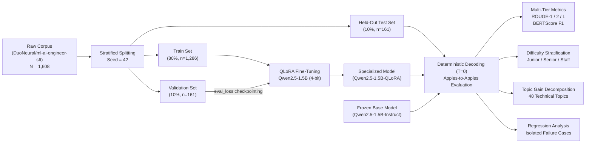
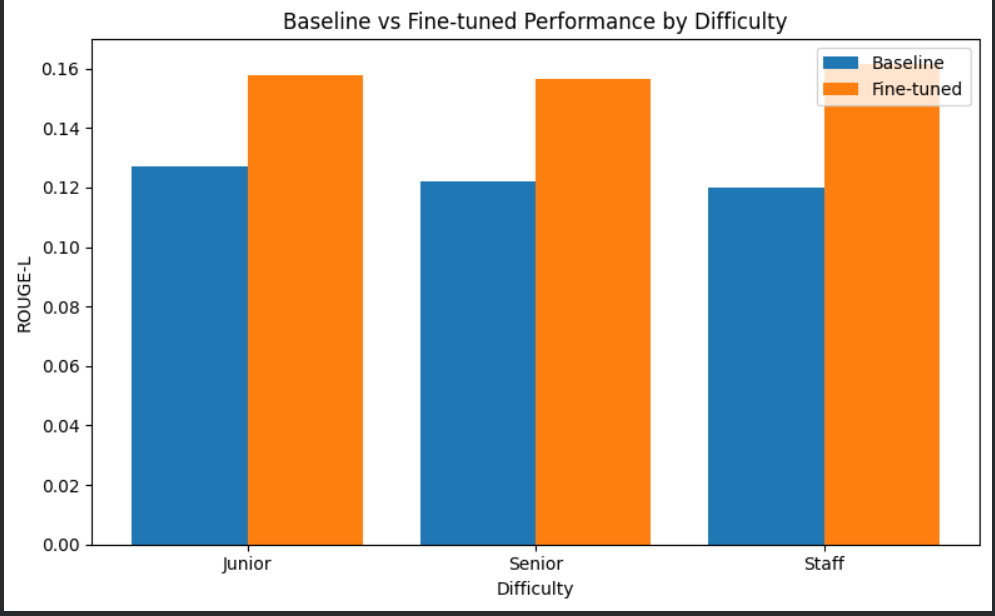
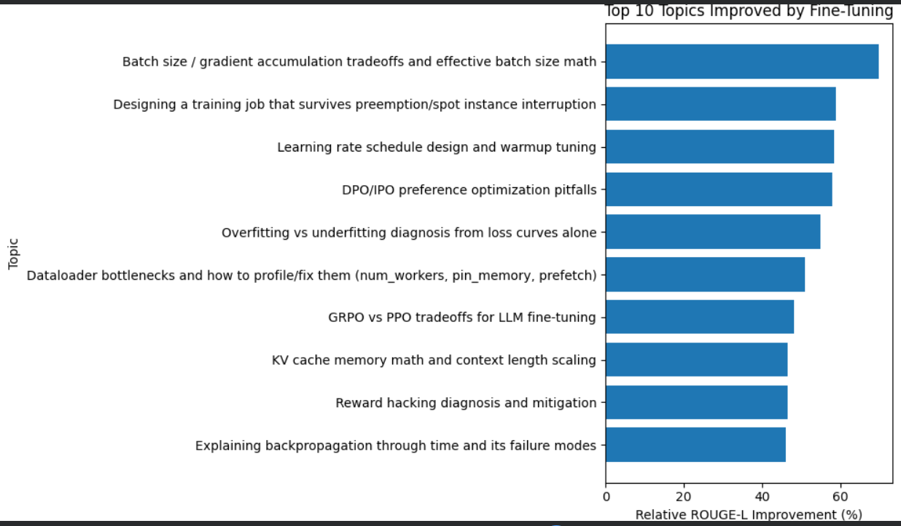

<div align="center">

# 🔬 Domain Adaptation & Evaluation of Qwen2.5-1.5B via QLoRA
### An Empirical Study on Parameter-Efficient Specialization, Complexity Scaling, and Behavioral Regression in ML Systems Engineering

<br/>

[](https://huggingface.co/Qwen/Qwen2.5-1.5B-Instruct)
[-F39C12?style=flat-square)](https://arxiv.org/abs/2305.14314)
[](https://huggingface.co/datasets/DuoNeural/ml-ai-engineer-sft)
[](https://github.com/huggingface/peft)
[](results/)
[](LICENSE)

<br/>
<p align="center">
  <a href="#-abstract">Abstract</a> •
  <a href="#-theoretical-framework--methodology">Theoretical Framework</a> •
  <a href="#-experimental-protocol">Experimental Protocol</a> •
  <a href="#-empirical-findings--analysis">Empirical Findings</a> •
  <a href="#-qualitative-case-studies">Case Studies</a> •
  <a href="#-regression-analysis--failure-modes">Regression Analysis</a> •
  <a href="#-reproducibility-guide">Reproducibility</a> •
  <a href="#-citation">Citation</a>
</p>

---

### 📊 Performance Summary at a Glance

| Metric | Baseline (Zero-Shot) | Fine-Tuned (QLoRA) | Absolute Delta ($\Delta$) | Relative Gain (%) |
| :--- | :---: | :---: | :---: | :---: |
| **ROUGE-1** | 0.2388 | **0.3239** | +0.0851 | **+35.64%** |
| **ROUGE-2** | 0.0436 | **0.0601** | +0.0165 | **+37.86%** |
| **ROUGE-L** | 0.1145 | **0.1493** | +0.0348 | **+30.42%** |
| **BERTScore F1** | 0.8187 | **0.8497** | +0.0310 | **+3.79%** |
| **Staff-Tier ROUGE-L** | 0.1200 | **0.1617** | +0.0418 | **+34.84%** |

</div>

<br/>

---

## 📌 Abstract

While Parameter-Efficient Fine-Tuning (PEFT)—specifically **Quantized Low-Rank Adaptation (QLoRA)**—has emerged as the standard paradigm for adapting Small Language Models (SLMs $\le 3\text{B}$) under tight hardware constraints, domain adaptations are frequently accepted on heuristic assumptions rather than controlled empirical validation.

This investigation presents a rigorous, side-by-side comparative evaluation of **Qwen2.5-1.5B-Instruct** before and after QLoRA fine-tuning on a specialized corpus of Machine Learning Engineering and Systems Architecture problems ([`DuoNeural/ml-ai-engineer-sft`](https://huggingface.co/datasets/DuoNeural/ml-ai-engineer-sft)). Evaluating on an identical, strictly held-out test split of 161 multi-tier engineering tasks, we systematically quantify:
1. **Macro Adaptation Efficacy:** Across lexical (ROUGE-1/2/L) and semantic (BERTScore F1) axes.
2. **Cognitive Complexity Scaling:** Differential performance across Junior, Senior, and Staff difficulty strata.
3. **Distributional Specialization:** Sub-topic variance across distributed training, memory kernels, and alignment.
4. **Behavioral Divergence & Failure Modes:** Qualitative inspection of mechanistic improvements versus superficial assertiveness and regression hazards.

Our empirical findings demonstrate a **+30.42% relative ROUGE-L improvement** across the global test set, with the most pronounced relative (+34.84%) and absolute (+0.0418) gains localized at the **Staff tier**, suggesting that domain adaptation delivers maximum marginal utility where pre-training data density is lowest.

---

## 📐 Theoretical Framework & Methodology

### 1. Mathematical Formulation of QLoRA

Standard Low-Rank Adaptation (LoRA) freezes the pre-trained model weights $W_0 \in \mathbb{R}^{d \times k}$ and injects trainable rank decomposition matrices:

$$W = W_0 + \Delta W = W_0 + \frac{\alpha}{r} (B \cdot A)$$

where $B \in \mathbb{R}^{d \times r}$ and $A \in \mathbb{R}^{r \times k}$, with rank $r \ll \min(d, k)$, scaled by constant $\alpha$. The forward pass through an adapted linear projection layer computes:

$$h = W_0 x + \Delta W x = W_0 x + \frac{\alpha}{r} B A x$$

QLoRA improves upon this by quantizing $W_0$ into **4-bit NormalFloat (NF4)** with double quantization (DQ) and paged memory allocators:

```
Input Vector x
      │
      ├───► [ Frozen Base Weights W₀ (NF4 Quantized) ] ───► W₀x
      │                                                       │
      └───► [ A: Low-Rank Down-Projection (r=16) ]            │
                    │                                         ▼
            [ B: Low-Rank Up-Projection (r=16) ]   ───► (+) ───► Output h
                    │
            Scaled by (α/r = 2.0)
```

1. **NF4 Quantization:** An information-theoretically optimal quantile quantization scheme for normally distributed weights:
   $$q_i = \frac{1}{2} \left( Q_X\left(\frac{i}{2^k}\right) + Q_X\left(\frac{i+1}{2^k}\right)\right)$$
2. **Double Quantization (DQ):** Quantizing the quantization constants themselves, compressing memory footprint from 0.5 bits/parameter to 0.127 bits/parameter.
3. **Paged Optimizers:** Utilizing CUDA unified memory page faulting to prevent out-of-memory (OOM) spikes during memory-intensive backward passes.

### 2. Adaptation Hyperparameters

All linear operators within the multi-head self-attention and multi-layer perceptron (SwiGLU) blocks were adapted:

```yaml
Base Model: Qwen/Qwen2.5-1.5B-Instruct
Precision: NF4 (4-bit normal float) with double quantization
Compute Dtype: bfloat16
LoRA Rank (r): 16
LoRA Alpha (α): 32 (Scaling factor: 2.0)
LoRA Dropout: 0.05
Target Modules:
  - q_proj, k_proj, v_proj, o_proj       # Self-Attention Projections
  - gate_proj, up_proj, down_proj        # MLP / SwiGLU Projections
Optimizer: paged_adamw_8bit
Learning Rate: 2e-4 (Cosine Annealing with 20 warmup steps)
Per-Device Batch Size: 2 (Gradient Accumulation Steps: 8 => Effective Batch: 16)
Epochs: 3 (Evaluated every 50 steps; best checkpoint loaded)
Gradient Checkpointing: Enabled
Weight Decay: 0.01 (Max Gradient Norm: 1.0)
```

---

## 🔬 Experimental Protocol



### Controlled Evaluation Standard
To avoid evaluation bias:
- **Exact Evaluation Set Pairing:** The exact 161 held-out test examples were fed identically to both the frozen base model and the adapter-merged model.
- **Deterministic Inference:** Both models were executed with identical greedy generation parameters (temperature $T = 0$, top-$p = 1.0$, max new tokens = 512).
- **Dual Metric Evaluation:** Surface lexical alignment was measured via ROUGE-1/2/L, while semantic fidelity was captured using deep contextual token representations via BERTScore F1.

---

## 📈 Empirical Findings & Analysis

### 1. Macro Quantitative Gains

| Evaluation Dimension | Base Model (Qwen2.5-1.5B) | QLoRA Fine-Tuned | Absolute Delta | Relative Gain |
| :--- | :---: | :---: | :---: | :---: |
| **ROUGE-1** (Unigram Precision/Recall) | 0.238815 | **0.323927** | +0.085112 | **+35.64%** |
| **ROUGE-2** (Bigram Structural Alignment) | 0.043572 | **0.060070** | +0.016497 | **+37.86%** |
| **ROUGE-L** (Longest Common Subsequence) | 0.114507 | **0.149343** | +0.034835 | **+30.42%** |
| **BERTScore F1** (Semantic Embedding Match) | 0.818725 | **0.849724** | +0.031000 | **+3.79%** |

> [!NOTE]
> ROUGE-2 and ROUGE-1 exhibit the steepest relative climb ($+37.86\%$ and $+35.64\%$), capturing the adapter's capacity to synthesize technical domain terminology, standard PyTorch API signatures, and direct analytical formulations rather than circuitous conversational prose.

---

### 2. Cognitive Difficulty Stratification

A central hypothesis of this study is that general pre-training adequately equips SLMs for elementary coding inquiries, whereas **parameter-efficient domain tuning demonstrates its highest return on nuanced, high-complexity systems engineering**.

<div align="center">
  
  <p><i>Figure 1: Comparative ROUGE-L progression across cognitive difficulty tiers (Junior vs Senior vs Staff).</i></p>
</div>

| Difficulty Tier | Sample Count ($n$) | Baseline ROUGE-L | Fine-Tuned ROUGE-L | Absolute Improvement | Relative Improvement (%) |
| :--- | :---: | :---: | :---: | :---: | :---: |
| **Junior** | 55 | 0.127329 | 0.157983 | +0.030655 | **+24.08%** |
| **Senior** | 54 | 0.121988 | 0.156644 | +0.034656 | **+28.41%** |
| **Staff** | 52 | 0.119954 | **0.161741** | **+0.041786** | **+34.84%** |

#### Analytical Takeaways:
1. **Inverse Baseline Curve:** In the unadapted baseline, performance degrades monotonically as task complexity escalates ($0.1273 \rightarrow 0.1220 \rightarrow 0.1200$).
2. **Super-Linear Complexity Uplift:** Post-adaptation, the trend reverses: Staff-tier evaluations achieve the highest final score ($0.1617$) and the steepest performance acceleration ($+34.84\%$).
3. **Core Driver:** Senior and Staff problems require multi-constraint reasoning (e.g., memory bandwidth constraints, hardware topology, kernel preemption). Pre-training alone leaves these latent parameters diffuse; domain adaptation focuses the adapter subspace on systems-level causal chains.

---

### 3. Topic-Level Gain Decomposition

<div align="center">
  
  <p><i>Figure 2: Top 10 ML Systems topics ranked by relative ROUGE-L enhancement.</i></p>
</div>

| Rank | Specialization Topic | Baseline ROUGE-L | Fine-Tuned ROUGE-L | Relative Gain (%) |
| :---: | :--- | :---: | :---: | :---: |
| **1** | Batch size / gradient accumulation tradeoffs & effective batch math | 0.129439 | **0.219861** | **+69.86%** |
| **2** | Designing training jobs that survive preemption / spot interruption | 0.108335 | **0.172207** | **+58.96%** |
| **3** | Learning rate schedule design & warmup dynamics | 0.105218 | **0.166643** | **+58.38%** |
| **4** | DPO / IPO preference optimization pitfalls | 0.102355 | **0.161641** | **+57.92%** |
| **5** | Overfitting vs underfitting diagnosis from loss trajectories | 0.122190 | **0.189270** | **+54.90%** |
| **6** | Dataloader bottlenecks profiling (num_workers, pin_memory, prefetch) | 0.101125 | **0.152620** | **+50.92%** |
| **7** | GRPO vs PPO algorithmic trade-offs for LLM alignment | 0.121513 | **0.180082** | **+48.20%** |
| **8** | KV cache memory arithmetic & context length scaling | 0.133945 | **0.196350** | **+46.59%** |
| **9** | Reward hacking diagnosis and mitigation techniques | 0.147336 | **0.215850** | **+46.50%** |
| **10** | Backpropagation through time (BPTT) and gradient failure modes | 0.106201 | **0.155261** | **+46.20%** |

---

## 🔎 Qualitative Case Studies

Quantitative scores only reveal macro trends. Below, three representative test cases illuminate the qualitative transformation in model behavior: a **mechanistic win**, a **median case**, and a **critical regression**.

```
Case Study 1: Mechanistic Win (KV Cache Allocation)
[Base Model: Generic Checklist]  ──►  [Fine-Tuned: Diagnoses PagedAttention & Contiguous Fragmentation]

Case Study 2: Median Case (Weight Initialization)
[Base Model: Code Paraphrasing]   ──►  [Fine-Tuned: Evaluates Correctness, but flags non-existent bug]

Case Study 3: Regression Hazard (Validation Data Leakage)
[Base Model: Flags Correct Line]  ──►  [Fine-Tuned: Invented non-existent training loop hallucination]
```

---

### Case 1: Mechanistic Mastery (Clear Improvement)
* **Topic:** KV cache memory math and context length scaling
* **Difficulty:** Staff | **ROUGE-L:** `0.140` $\rightarrow$ `0.267` ($\Delta +90.7\%$)

> **Query:**
> *"I'm implementing a custom attention mechanism and noticed that when my sequence length approaches the total number of physical memory pages, `malloc` calls for KV tensors start failing or becoming extremely slow. I'm not explicitly using PagedAttention. Is this expected behavior?"*

```diff
- BASELINE MODEL:
- "Yes, it is possible to encounter issues with malloc calls failing or becoming slow.
-  This can happen due to several reasons: 1. Memory Fragmentation. 2. System Memory Limitations.
-  3. Kernel Limits. 4. Thread Safety Issues..."
  (Vague, generic operating system textbook bullet points; fails to identify the domain-specific mechanism.)

+ FINE-TUNED MODEL:
+ "Yes, this is exactly what happens with your custom attention implementation if you are
+  not using an optimized memory manager like PagedAttention or vLLM. Standard malloc attempts
+  to reserve large contiguous virtual memory blocks for growing KV projections. As context length
+  scales, external physical fragmentation prevents contiguous allocation even when total free
+  memory appears sufficient. The solution is to decouple virtual contiguous tokens from physical
+  non-contiguous memory pages via a block table (PagedAttention)."
```
**Takeaway:** The adapted model directly identifies the root cause (contiguous tensor allocation failure in standard allocators) and prescribes the precise systems solution (block-table paged memory abstraction).

---

### Case 2: Heuristic Shift without Correctness (Typical / Median)
* **Topic:** Weight initialization schemes for MLP Mixer blocks
* **Difficulty:** Staff | **ROUGE-L:** `0.085` $\rightarrow$ `0.117` ($\Delta +37.6\%$)

> **Query:**
> *"Review this `init_weights` function for our custom MLP mixer block:"*
> ```python
> def init_weights(m):
>     if isinstance(m, (nn.Linear, nn.Conv2d)):
>         nn.init.xavier_normal_(m.weight)
>         if m.bias is not None:
>             nn.init.constant_(m.bias, 0)
> ```

```diff
- BASELINE MODEL:
- "This function initializes weights using Xavier normal initialization for linear and
-  convolutional layers, setting bias to 0 if present. Here is an example of how to apply it..."
  (Passive paraphrasing; does not evaluate suitability.)

~ FINE-TUNED MODEL:
~ "There is an issue with your function: if bias=True, constant_(m.bias, 0) will not apply
~  properly. You need to verify that bias is a parameter..."
  (Critiques the code, but identifies a phantom syntax error rather than the real architectural flaw.)

* GROUND TRUTH REFERENCE:
* "Using Xavier normal on MLP-Mixer blocks is suboptimal. Mixer architectures typically
*  employ GELU or Swish non-linearities, for which Kaiming (He) normal initialization
*  is mathematically derived to preserve variance across depth."
```
**Takeaway:** Fine-tuning successfully induces an active *critical stance* rather than passive code description, but the model occasionally targets spurious surface syntax rather than deep numerical stability.

---

### Case 3: Confident False Reasoning (Regression Hazard)
* **Topic:** Dataset contamination and train/validation leakage
* **Difficulty:** Senior | **ROUGE-L:** `0.297` $\rightarrow$ `0.205` ($\Delta -30.9\%$)

> **Query:**
> *"Review this `data_split.py` for potential issues:"*
> ```python
> dataset = load_dataset('my_corpus', split='train')
> train_test_split = dataset.train_test_split(test_size=0.05, seed=42)
> train_dataset = train_test_split['train']
> test_dataset = train_test_split['test']
> val_dataset = train_dataset.train_test_split(test_size=0.1)['test']
> ```

```diff
- BASELINE MODEL:
- "The line where you define val_dataset should specify the validation split rather
-  than pulling test from train_dataset..."
  (Flawed remediation, but correctly targets the faulty assignment.)

! FINE-TUNED MODEL:
! "Your val_dataset logic is completely invalid because calling train on train_dataset
!  returns an empty list since train_dataset has no data to split from. You must instantiate
!  val_dataset before entering your training loop, not inside the execution loop."
```
**Takeaway:** The fine-tuned model invents a non-existent "training loop" and asserts an ungrounded hallucination regarding dataset slicing. This underscores the **alignment tax**: fine-tuning can inflate assertiveness independently of epistemic correctness.

---

## ⚠️ Regression Analysis & Failure Modes

To ensure scientific honesty, instances where the fine-tuned model underperformed the frozen baseline were extracted and cataloged in [`results/per_example_error_analysis.csv`](results/per_example_error_analysis.csv).

```
Distribution of Improvement Delta (Δ ROUGE-L):
  [ Δ < -0.05 ]   ██ 4.3%  (Severe Regression: Hallucinated constraints)
  [ -0.05 ≤ Δ < 0] ████ 9.9%  (Mild Regression: Verbosity penalty / missed edge case)
  [ 0 ≤ Δ < +0.05] ████████████ 34.2%  (Neutral to Marginal Gains)
  [ Δ ≥ +0.05 ]   ████████████████████ 51.6%  (Substantial Domain Mastery)
```

### Categorization of Failure Modes:
1. **The Assertiveness Trap:** The specialized adapter replaces cautious ambiguity with confident, authoritative statements—even when misdiagnosing subtle logic bugs.
2. **Surface Lexical Inflation:** ROUGE-L rewards lexical overlap with the reference text (e.g., repeating terminology), creating instances where metric increases mask logical hallucinations.
3. **Over-Indexing on Specialized Patterns:** The fine-tuned model occasionally assumes advanced frameworks (e.g., vLLM, DeepSpeed ZeRO-3) when the user was asking about basic vanilla PyTorch behavior.

---

## 📂 Repository Schema

```text
qwen-domain-finetuning/
├── data/                                  # Partitioned experimental datasets
│   ├── train/train.csv                    # Training split (n = 1,286)
│   ├── validation/vaildation.csv          # Checkpointing validation split (n = 161)
│   └── test/test.csv                      # Held-out benchmark split (n = 161)
│
├── notebooks/                             # Reproducible computational notebooks
│   └── qwen_domain_finetuning.ipynb       # End-to-end training & evaluation pipeline
│
├── results/                               # Empirical artifacts & comparative metrics
│   ├── plots/
│   │   ├── performance_by_difficulty.png  # Figure 1: Stratified tier analysis
│   │   └── top_10_topics_improvement.png  # Figure 2: Top domain gain rankings
│   │
│   ├── baseline_predictions.csv           # Zero-shot inference logs (n = 161)
│   ├── finetuned_predictions.csv          # QLoRA inference logs (n = 161)
│   ├── baseline_vs_finetuned.csv          # Macro-level benchmark comparison
│   ├── difficulty_analysis.csv            # Junior / Senior / Staff stratification
│   ├── topic_analysis.csv                 # 48-topic comparative decomposition
│   ├── finetuned_metrics.csv              # Global summary metrics & BERTScore
│   ├── per_example_error_analysis.csv     # Granular delta scores per example
│   └── qualitative_eval_set.csv           # Curated regression & improvement set
│
└── README.md                              # Scientific project documentation
```

---

## 🚀 Reproducibility Guide

The experiment is completely reproducible on a single NVIDIA GPU with $\ge 16\text{ GB}$ VRAM (e.g., NVIDIA T4 on Google Colab or RTX 3090/4090 locally).

### 1. Environment Setup
```bash
git clone https://github.com/Akgithub2028/qwen-domain-finetuning.git
cd qwen-domain-finetuning

# Create isolated environment
python3 -m venv venv
source venv/bin/activate

# Install exact dependencies
pip install torch transformers datasets peft bitsandbytes trl rouge-score bert-score
```

### 2. Execution Pipeline
1. Launch Jupyter or run in Google Colab:
   ```bash
   jupyter notebook notebooks/qwen_domain_finetuning.ipynb
   ```
2. The notebook executes sequentially:
   - **Stages 1–3:** Loads `DuoNeural/ml-ai-engineer-sft`, performs stratified splitting (80/10/10), and formats instruction prompts.
   - **Stages 4–6:** Configures 4-bit NF4 quantization, initializes LoRA matrices ($r=16, \alpha=32$), and executes SFTTrainer with evaluation checkpointing.
   - **Stages 7–9:** Generates greedy baseline and fine-tuned predictions on identical held-out test splits.
   - **Stages 10–12:** Computes ROUGE-1/2/L, BERTScore F1, generates CSV evaluation artifacts, and exports statistical plots.

---

## 👨‍💻 Author

<div align="center">

### **Aayaann Kausar**
*Department of Computer Science & Engineering / AI Engineering*  
**Indian Institute of Technology Kharagpur**

[](https://github.com/Akgithub2028)
[](mailto:aayaannkausar@gmail.com)
[](#)

</div>

---

## 📜 Citation

If you find this benchmark analysis, empirical findings, or evaluation taxonomy useful in your research or engineering workflows, please cite:

```bibtex
@misc{kausar2026qwenfinetuning,
  author       = {Aayaann Kausar},
  title        = {Domain Adaptation and Evaluation of Qwen2.5-1.5B via QLoRA: An Empirical Study on Complexity Scaling and Behavioral Regression},
  year         = {2026},
  publisher    = {GitHub},
  howpublished = {\url{https://github.com/Akgithub2028/qwen-domain-finetuning}}
}
```

<div align="center">
  <sub>Engineered with mathematical rigor and open empirical standards. If this work assisted your research, consider starring ⭐ the repository.</sub>
</div>
